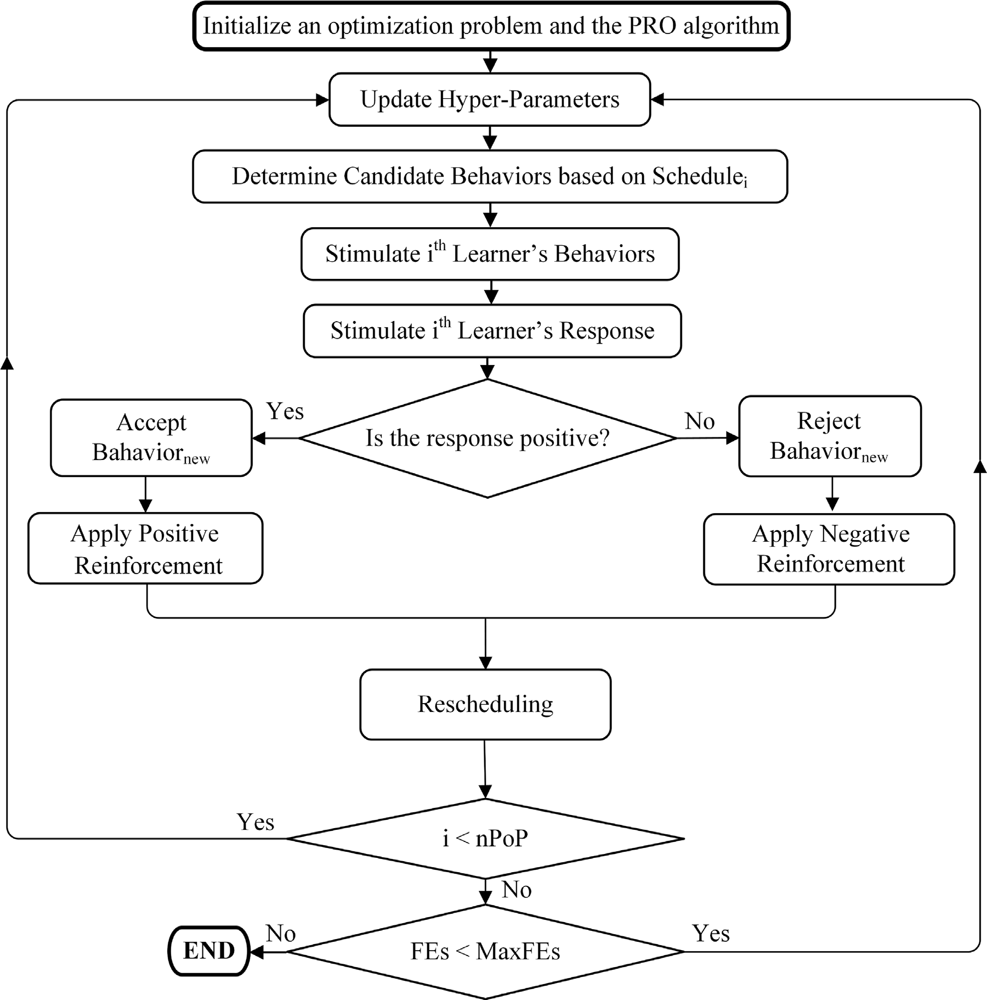
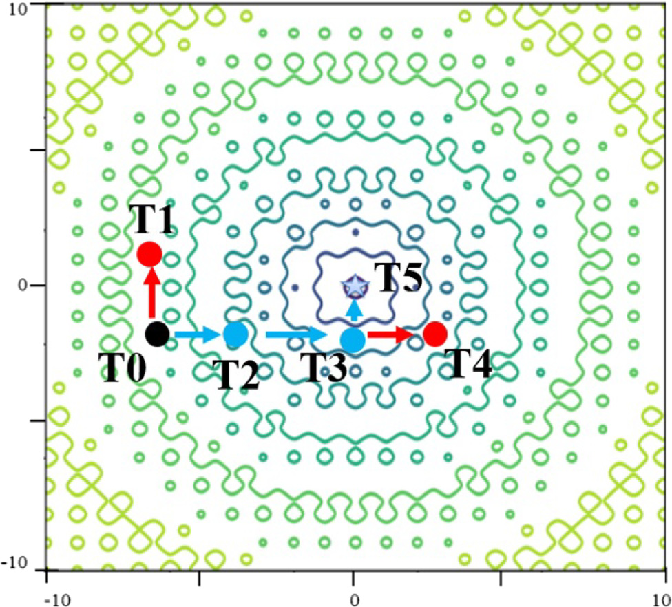

# Partial Reinforcement Optimizer (PRO)

MATLAB implementation of the Partial Reinforcement Optimizer (PRO) for box-constrained minimization. PRO draws on the *partial reinforcement effect* in learning. In the optimizer, each candidate solution is a learner, its decision variables are behaviors, and a schedule records which variables to change next.

## Quick start

Clone the repository and open its root folder in MATLAB. The optimizer and sphere example use base MATLAB.

```matlab
rng(42, 'twister');
sphereCost = @(x) sum(x.^2);
[x, f, history] = pro(sphereCost, 10, -100, 100, 30, 10000);
```

This minimizes the 10-dimensional sphere function with 30 learners and 10,000 objective evaluations. The known minimum is zero at the origin. Run `Run_PRO` for a convergence plot.

## How PRO searches

Each learner ranks its variables by schedule priority and selects a subset to update. PRO either moves those variables toward the best solution seen so far or moves them away from a lower-ranked peer. It evaluates the candidate once. If its cost improves, the learner accepts the move and raises the priorities of the selected variables. Otherwise, it keeps its previous position and lowers those priorities. When all priorities become equal, PRO draws a new position and schedule for that learner.



*Figure 5 from Taheri et al. The flowchart shows how a learner's objective value determines which reinforcement step follows.*



*Figure 6 from Taheri et al. At T1, changing X2 fails to improve the objective, so its priority falls from 0.6 to 0.3. At T2, changing X1 improves the objective, so its priority rises to 0.6.*

The paper evaluates PRO on 75 functions from CEC2005, CEC2014, and CEC-BC-2017, using Wilcoxon and Friedman tests to compare optimizers. It also applies PRO to a federated deep learning classifier for electrocardiograms. [Read the paper](https://doi.org/10.1016/j.eswa.2023.122070).

## MATLAB API

```matlab
[x, f, history] = pro(objective, n, lb, ub, populationSize, maxEvaluations)
```

- `objective` receives a 1-by-`n` row vector and returns a real scalar cost. Smaller values are better.
- `lb` and `ub` may be scalars or vectors of length `n`. Equal bounds fix a coordinate.
- `maxEvaluations` must be at least `populationSize`. The budget includes initialization, candidate evaluations, and rescheduling.
- `x` is the best position observed, `f` its cost, and `history(j)` the best cost through evaluation `j`. The optimizer uses the caller's random stream.

## Running an external CEC2017 benchmark

Keep the benchmark in a separate directory with its original `input_data/` folder. Add the PRO repository to the MATLAB path and change the working directory to the benchmark folder. The original evaluator opens data files relative to the working directory. Use a MEX binary built for your platform, or compile the supplied source with a configured MATLAB C++ compiler.

```matlab
addpath('/absolute/path/to/Partial-Reinforcement-Optimizer');
cd('/absolute/path/to/PRO Matlab Code CEC2017');
% If your platform needs a new binary, compile once:
% mex cec17_func.cpp
rng(42, 'twister');
functionId = 1;
objective = @(x) cec17_func(x(:), functionId);
[x, f, history] = pro(objective, 10, -100, 100, 30, 100000);
```

If the benchmark directory also contains the original MATLAB scripts, MATLAB gives those local scripts precedence. The example above calls the new `pro` entry point directly.

Existing experiments with pre-evaluated learners can use the original calling convention:

```matlab
[BestCosts, BestSolCost] = PRO_v1(N, MaxFEs, LB, UB, population, pop_size, ObjFunc_ID);
```

Each learner supplies `Position` and `Cost`. Here `MaxFEs` counts **additional** objective calls. Both entry points now count rescheduled learners, retain improvements found during rescheduling, and stop exactly at the requested budget. These changes and caller-controlled seeding can produce different convergence traces from the 2023 scripts.

## Tests

Run from the repository root:

```matlab
addpath('tests');
test_pro
```

## Citation

Taheri, A., RahimiZadeh, K., Beheshti, A., Baumbach, J., Rao, R. V., Mirjalili, S., & Gandomi, A. H. (2024). Partial reinforcement optimizer: An evolutionary optimization algorithm. *Expert Systems with Applications, 238*, 122070. [DOI 10.1016/j.eswa.2023.122070](https://doi.org/10.1016/j.eswa.2023.122070)

```bibtex
@article{taheri2024pro,
  author  = {Taheri, Ahmad and RahimiZadeh, Keyvan and Beheshti, Amin and
             Baumbach, Jan and Rao, Ravipudi Venkata and Mirjalili, Seyedali and
             Gandomi, Amir H.},
  title   = {Partial reinforcement optimizer: An evolutionary optimization algorithm},
  journal = {Expert Systems with Applications},
  year    = {2024},
  volume  = {238},
  pages   = {122070},
  doi     = {10.1016/j.eswa.2023.122070}
}
```

## License

The MATLAB code is distributed under the [Apache License 2.0](LICENSE). Figures 5 and 6 are reproduced from the cited paper.
